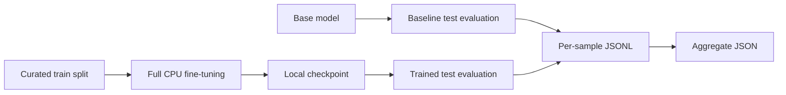
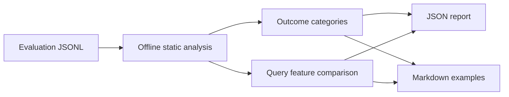

# SmolLM2 Text-to-Cypher

A modular CPU training and evaluation pipeline that fine-tunes `HuggingFaceTB/SmolLM2-135M-Instruct` to generate Cypher from a natural-language question and a Neo4j graph schema. It uses `RomanTeucher/text2cypher-curated`, with 1,000 training, 75 validation, and 50 test samples.

## Contents

- [Setup](#setup)
- [Reproducible workflow](#reproducible-workflow)
- [Artifacts and metrics](#artifacts-and-metrics)
- [Evaluation-result analysis implementation](#evaluation-result-analysis)
- [Manual evaluation](RESULT_ANALYSIS.md)
- [Configuration](#configuration)
- [Neo4j](#neo4j)
- [Design decisions and limitations](DESIGN_DECISIONS.md)

## Setup

Requirements:

- Python 3.11 or newer
- `uv`
- Network access to Hugging Face on the first run
- Docker and a reachable local Neo4j service for mandatory training-target compilation validation

Install locked dependencies:

```sh
make install
```

Copy [.env.example](.env.example) to `.env` only as a local reference, then export settings in the shell; programs do not load `.env` automatically. Keep secrets out of version control.

## Reproducible workflow



Verify the selected model, prepared dataset, and local Neo4j service:

```sh
make neo4j-up
make run-smoke
```

The smoke test reports the sample count for every database-reference alias in the curated test split. Missing or empty aliases are grouped as `<unset>`.

The default smoke test uses the base model. To test a completed local checkpoint instead, pass its directory through `SMOKE_ARGS`:

```sh
make run-smoke SMOKE_ARGS='--model outputs/runs/current/model'
```

Produce an untrained baseline on all test samples:

```sh
make baseline-evaluate
```

Training first sends every train and validation reference Cypher target to Neo4j as `EXPLAIN <query>`. Queries Neo4j cannot compile are rejected before tokenization, and an unavailable Neo4j service stops training. `EXPLAIN` compiles and plans a query but does not execute it, including write-shaped targets. Start Neo4j before training; an imported graph snapshot is not required for ordinary syntax validation:

```sh
make neo4j-up
make train
make train TRAIN_ARGS='--max-steps 2'
```

The syntax check is enabled by default. The validation connection defaults to `NEO4J_URI`, `NEO4J_USER`, and `NEO4J_PASSWORD`; override them or set the positive timeout when needed. Disable it only for a controlled comparison:

```sh
make train TRAIN_ARGS='--validation-uri bolt://localhost:7687 --validation-timeout 20'
make train RUN=without-syntax-check TRAIN_ARGS='--no-syntax-check'
```

Each named run is isolated below `outputs/runs/<run>/`: `model/` holds the checkpoint and its non-sensitive `run_config.json`, while `evaluation/` holds result and analysis artifacts. The default run is `current`; choose a descriptive run name to preserve experiments:

```sh
make train RUN=syntax-check-v1
make test-analyze RUN=syntax-check-v1
make train RUN=without-syntax-check TRAIN_ARGS='--no-syntax-check'
make test-analyze RUN=without-syntax-check
make compare-runs
```

`make test-analyze` evaluates the selected run's trained model and writes its static analysis. `make compare-runs` discovers every completed baseline and trained evaluation artifact below `outputs/runs/*/evaluation/` and writes aggregate and all-pair comparison reports under `outputs/runs/comparisons/`.

For the existing experiment folders that predate the named-run layout, compare every matching folder in the project root with:

```sh
make compare-runs RUNS_DIR=. COMPARISON_DIR=outputs/comparisons
```

Training uses `--device auto` by default: it selects CUDA if the installed PyTorch build can access an NVIDIA GPU, otherwise CPU. Select a device explicitly when required:

```sh
make train TRAIN_ARGS='--device cuda'
make train TRAIN_ARGS='--device cpu'
```

`--device cuda` fails before training if CUDA is unavailable, rather than silently falling back to CPU.

Evaluate the local final checkpoint:

```sh
make evaluate
```

For smoke testing or separate analysis, select any supported split and filter by
whether `database_reference_alias` is populated. `set` selects non-empty aliases;
`unset` selects missing or empty aliases:

```sh
make baseline-evaluate EVALUATE_ARGS='--split val --database-reference-alias set'
make evaluate EVALUATE_ARGS='--split train --database-reference-alias unset'
```

Limit an evaluation to a small filtered subset while checking the pipeline. A progress bar shows completed samples, and each completed result is immediately appended to the JSONL file:

```sh
make baseline-evaluate EVALUATE_ARGS='--split val --database-reference-alias set --limit 3'
```

Analyze a completed evaluation artifact to identify the lexical query forms the model reproduces and its static output failure modes. The report includes up to five true-positive examples (lexical exact match or execution match) and true-negative examples (lexical non-match without an execution match); a null execution match is treated as not execution-matched. False-positive and false-negative categories remain empty because no independent semantic-equivalence label is available:

```sh
make analyze-results LABEL=baseline
make analyze-results LABEL=trained ANALYZE_ARGS='--max-examples 5'
```

Upload only after authenticating with the Hugging Face CLI. Publishing is explicit and never automatic:

```sh
make upload-model HF_REPO_ID=your-account/smollm2-text2cypher
```

## Artifacts and metrics

Baseline and trained evaluation write results below the selected `outputs/runs/<run>/evaluation/` directory. Every compact JSONL record includes the instance ID, schema, question, ground-truth and generated Cypher, generation error, and generated-versus-ground-truth exact match, token precision, recall, and F1 in its `metrics` field. `metrics.execution_match` is `true` or `false` when opt-in execution comparison ran and `null` when it did not. The artifact omits redundant comparison objects and per-record generation settings. The aggregate JSON reports mean lexical metrics and failed-generation count.

Training writes `outputs/runs/<run>/model/loss_curve.png` after it completes. The diagram contains the periodic training loss and the end-of-epoch validation loss recorded by the Trainer.

`scripts/evaluate.py` accepts `--split train|val|test` (default: `test`), `--database-reference-alias any|set|unset` (default: `any`), and `--limit N`. The same options are forwarded by `EVALUATE_ARGS` in the Makefile targets.

These lexical metrics are transparent for comparing base and trained checkpoints, but do not demonstrate semantic or execution equivalence.

For supported, alias-backed examples, opt in to execution equivalence after importing the matching snapshot. The evaluator executes the reference and generated query only when the row alias matches the explicit `--execution-graph`, then compares result rows. For example:

```sh
make neo4j-import GRAPH=movies
make baseline-evaluate EVALUATE_ARGS='--split test --database-reference-alias set --limit 3 --execute --execution-graph movies'
```

Execution evaluation uses `NEO4J_URI`, `NEO4J_USER`, and `NEO4J_PASSWORD` when set (or the local defaults). It allows only conservative read-oriented Cypher, rejects procedures and write clauses, limits every query to ten seconds by default, and skips rows with an unmatched or missing alias. Reference queries containing `ORDER BY` are compared in order; other results are compared as duplicate-preserving multisets. The optional `execution` JSONL field and summary section report skipped rows, database errors, and equivalence outcomes without recording credentials.

## Evaluation-result analysis

`make analyze-results LABEL=baseline` reads the selected run's baseline result JSONL and writes its JSON and Markdown analysis to the same evaluation directory. Use `LABEL=trained` after `make evaluate`, or override `EVALUATION_DIR` when evaluating elsewhere.

The report groups each output into generation errors, empty outputs, exact lexical matches, Cypher-shaped lexical non-matches, SQL-shaped outputs, prose or Markdown outputs, and other non-Cypher outputs. It also reports token-overlap bands, static query-feature exact-match rates, feature gaps in Cypher-shaped non-matches, alias and query-complexity breakdowns, and a deterministic bounded set of representative examples.

The analysis is intentionally offline and dependency-free. Its feature detection is rule-based rather than a full Cypher parser. An exact lexical match does not prove execution equivalence, while a non-exact result may still be semantically correct; use execution-equivalence testing on compatible graph instances for those conclusions.



## Configuration

| Variable | Default | Purpose |
| --- | --- | --- |
| `HF_MODEL_ID` | `HuggingFaceTB/SmolLM2-135M-Instruct` | Base model and smoke-test model |
| `HF_DATASET_ID` | `RomanTeucher/text2cypher-curated` | Prepared Text-to-Cypher dataset |
| `TORCH_NUM_THREADS` | `4` | CPU thread cap; tune to available cores |
| `MAX_NEW_TOKENS` | `256` | Deterministic generation limit |
| `OUTPUT_DIR` | `outputs` | Parent directory for checkpoint and evaluation artifacts |
| `RUN` | `current` | Makefile name for the isolated run below `outputs/runs/` |
| `HF_REPO_ID` | unset | Required only for explicit model upload |
| `NEO4J_URI` | `bolt://localhost:7687` | Mandatory training Cypher compilation validation endpoint |
| `NEO4J_USER` | `neo4j` | User for local Neo4j validation and execution evaluation |
| `NEO4J_PASSWORD` | `password` | Password for local Neo4j validation and execution evaluation |
| `NEO4J_VALIDATION_TIMEOUT` | `10` | Per-target `EXPLAIN` timeout in seconds during syntax checking |

## Neo4j

Neo4j starts as a connection-only service. An explicit import can populate it with one supported graph snapshot for local exploration or opt-in, alias-scoped execution evaluation. A snapshot does not match every dataset example and an execution match remains relative to that one graph state.

| Target | Description |
| --- | --- |
| `make neo4j-pull` | Pull the configured Neo4j image |
| `make neo4j-up` | Replace and start the Neo4j container |
| `make neo4j-status` | Show container status |
| `make neo4j-logs` | Follow container logs |
| `make neo4j-down` | Stop and remove the container |
| `make neo4j-download GRAPH=movies` | Download the selected graph dump |
| `make neo4j-import GRAPH=movies` | Download, restore, and verify the selected graph |
| `make neo4j-reset` | Remove the persistent local Neo4j data volume |

The supported graph names are `movies`, `twitter`, `fincen`, `stackoverflow`, and `twitch`; `movies` is the default. Importing a graph replaces the current `neo4j` database. The Twitch graph requires Git LFS and can require substantial disk space. Game of Thrones and aliases without verified compatible dumps are intentionally excluded.

The execution graph names map only to their matching dataset aliases: Movies, Twitter/Twitter v2, FinCEN, Stack Overflow, and Twitch respectively. Alias-null, unsupported, and mismatched rows are skipped rather than executed against arbitrary data. `CALL` is deliberately unsupported even for otherwise read-oriented procedures, because no safe procedure allowlist exists yet.

Imported data persists in the Docker volume `fraunhofer-neo4j-data` when the container is replaced. Remove it only when a fresh database is intended:

```sh
make neo4j-reset
```

Override Make variables when needed, for example `make neo4j-import GRAPH=fincen NEO4J_AUTH=neo4j/a-secure-password`.
